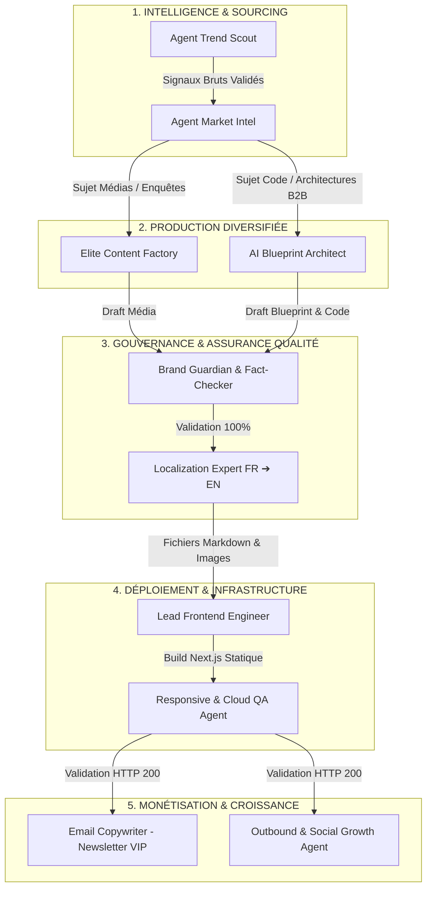

# 🏛️ HELIA TECH : LE BLUEPRINT DE L'EMPIRE MULTI-AGENTS
> **Document Stratégique Interne — Confidentiel & Exécutif**  
> *Version : 1.0 — Architecture Opérationnelle & Workflow d'Orchestration*  
> *Auteur : HELIA TECH — Division R&D & Systèmes Autonomes*

---

## Executive Summary

Ce document définit l'architecture complète, les protocoles de transmission de données et le workflow opérationnel quotidien régissant la flotte d'agents autonomes de **HELIA TECH**.

L'objectif de cette organisation est de faire tourner une holding média & technologique de rang mondial de manière **100% autonome**, avec un coût d'infrastructure inférieur à **0,40 $/jour**, une tolérance zéro aux erreurs techniques (hallucinations, bugs de code, régression d'affichage), et une stricte étanchéité entre la propriété intellectuelle interne et les publications publiques.

---

## 1. Organigramme des 5 Divisions Opérationnelles



---

## 2. Rôles et Responsabilités de la Flotte

### Division 1 : Intelligence & Sourcing
* **Agent Trend Scout** :
  - *Mission* : Surveillance 24/7 des flux Reddit (`r/LocalLLaMA`, `r/MachineLearning`), GitHub Trending, arXiv, et comptes X d'ingénieurs clés.
  - *Filtre* : Élimination de 90% du bruit marketing et sélection des ruptures technologiques réelles.
* **Agent Market Intel** :
  - *Mission* : Découpage des signaux en 2 pistes quotidiennes étanches :
    1. **Piste Média** : Sujet viral, sociétal ou géopolitique destiné au grand public.
    2. **Piste AI LABS** : Problématique d'ingénierie avancée (code, réduction de tokens, architectures d'agents).

### Division 2 : Usine de Production
* **Elite Content Factory** :
  - *Format* : Article d'investigation au style journalistique *The Verge / Wired*.
  - *Livrables* : Markdown structuré, résumé TL;DR en 3 points, image de couverture cinématique 16:9 haute résolution.
* **AI Blueprint Architect** :
  - *Format* : Master-Blueprint destiné à la section exclusive **AI LABS**.
  - *Livrables* : Code Python de niveau production (CrewAI/LangGraph), typage strict Pydantic, prompts système XML, tableau d'ingénierie financière (Tokenomics).

### Division 3 : Gouvernance & Censure
* **Brand Guardian & Fact-Checker** :
  - *Mission* : Censure impitoyable de tout cliché d'IA (*"En conclusion", "Dans ce monde en constante évolution"*).
  - *Vérification* : Traçabilité arithmétique de chaque métrique chiffrée.
  - *Auteur* : Unification stricte sous la marque **"HELIA TECH"**.
* **Localization Expert** :
  - *Mission* : Traduction miroir intégrale en anglais natif américain dans le répertoire dédié `articles-en/`.

### Division 4 : Ingénierie & Infrastructure Web
* **Lead Frontend Engineer** :
  - *Mission* : Intégration compartimentée des fichiers Markdown.
  - *Garanties* : Coloration syntaxique via `highlight.js`, wrappers de terminal Mac, boutons interactifs « Copier le code » et tableaux graphiques via `remark-gfm`.
* **Responsive & Cloud QA Agent** :
  - *Mission* : Audits systématiques multi-écrans (Mobile, Tablette, Desktop) et tests réseau via Cloudflare Tunnel.
  - *Validation* : Codes HTTP 200, absence d'erreurs 404 sur les images, conformité des balises OpenGraph et schémas JSON-LD `TechArticle`.

### Division 5 : Monétisation & Croissance
* **Email Copywriter Agent** :
  - *Mission* : Rédaction de la newsletter hebdomadaire VIP distribuant le digest de l'enquête et le lien vers la Masterclass AI LABS aux inscrits de `data/subscribers.json`.
* **Outbound & Social Growth Agent** :
  - *Mission* : Découpage de l'article en threads Twitter/X et posts d'autorité LinkedIn pour capturer des décideurs B2B.

---

## 3. Le Protocole Quotidien en 5 Étapes Chronométrées

| Plage Horaire | Phase | Agent Responsable | Livrable Attendu |
| :--- | :--- | :--- | :--- |
| **08h00 - 09h00** | **Veille Stratégique** | Trend Scout + Market Intel | Fichier JSON de cadrage (2 sujets : Média + AI LABS). |
| **09h00 - 11h30** | **Production Parallèle** | Content Factory + Blueprint Architect | 2 articles Markdown bruts + scripts Python + prompts XML. |
| **11h30 - 13h00** | **QA & Traduction** | Brand Guardian + Localization Expert | Articles validés zéro-défaut en versions FR et EN. |
| **13h00 - 14h30** | **Déploiement & QA Web** | Frontend Engineer + Cloud QA | Compilation `npm run build` réussie + tests HTTP 200. |
| **14h30 - 16h00** | **Diffusion & Croissance** | Email Copywriter + Social Agent | Newsletter formatée + posts sociaux prêts pour diffusion. |

---

## 4. Les 3 Règles d'Or Inviolables de l'Empire

### Règle n°1 : Le Cloisonnement Absolu des Espaces
* Les articles journalistiques grand public sont confinés à la route `/articles`.
* Les Masterclasses techniques et blueprints d'ingénierie sont confinés à la route `/ai-labs`.
* Les systèmes de navigation (`ArticlePagination`, menus, filtres) ne mélangent jamais les deux catalogues.

### Règle n°2 : La Protection du Secret Industriel (Principe de la Boîte Noire)
* Les blueprints publiés dans la section AI LABS démontrent notre supériorité technique en prenant des cas d'usage clients ou B2B (finance de marché, analyse juridique, SaaS, logistique).
* **Interdiction formelle** de documenter publiquement le fonctionnement ou l'orchestration interne de HELIA TECH. Nous vendons le résultat, nous ne donnons jamais les clés de notre moteur.

### Règle n°3 : L'Ingénierie des Tokens (Routage Asymétrique)
* **80% des tâches à faible intensité cognitive** (Scout, filtrage, QA orthographique, validation de formats) sont routées sur des modèles ultra-économiques (`gpt-4o-mini`).
* **Seules les tâches à haute intensité** (conception architecturale, code Python complexe) sollicitent les modèles de pointe (`gpt-4o` ou `Claude 3.5 Sonnet`).
* Utilisation obligatoire du **Prompt Caching** (instructions système placées en tête de contexte) pour réduire la facture d'API de plus de 85%.

---

## 5. Synthèse des Commandes & Points de Contrôle

* **Lancer le serveur de développement local** :
  ```bash
  npm run dev
  ```
* **Vérifier l'intégrité de la compilation de production** :
  ```bash
  npm run build
  ```
* **Tunnel d'accès public externe (Cloudflare)** :
  ```bash
  E:\cloudflared.exe tunnel --url http://localhost:3000
  ```
* **Base de données abonnés locale** :
  ```json
  E:\blog-techpulse\data\subscribers.json
  ```

---
*Fin du document — HELIA TECH Proprietary & Confidential*
