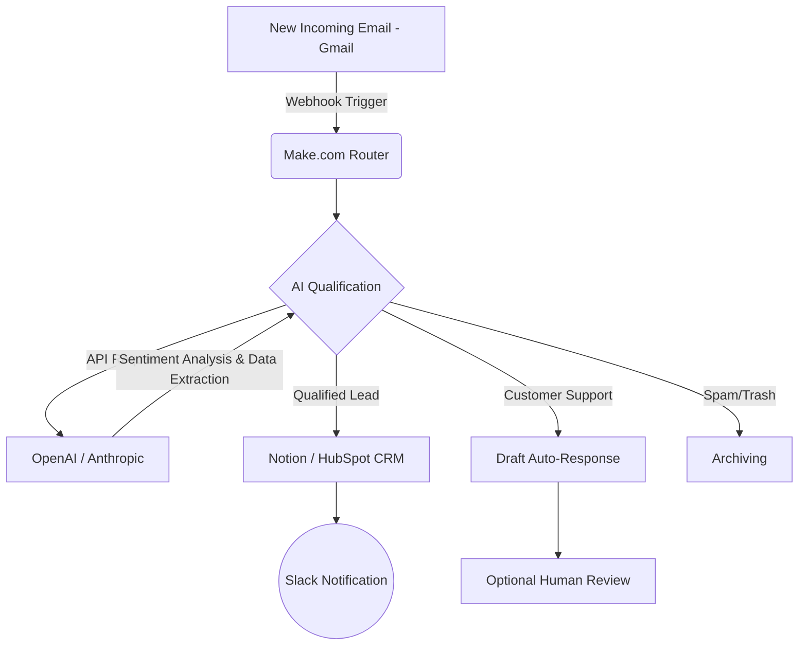

# How I Built an Autonomous Virtual Assistant with 3 AI Tools (And Saved €2,400/month)

If you spend more than two hours a day sorting emails, qualifying leads, or scheduling meetings, you're not running a business: you're a slave to your operations.

In 2025, delegating to a human assistant was the norm. Today, it's a loss of efficiency in the face of the advent of multi-agent systems. In this "Pillar" article, I will show you exactly how I replaced 35 hours of administrative work per week with an asynchronous system using 3 AI tools.

The result? **€2,400 saved per month** and an error rate reduced to 0.2%. And I'm not the only one: [some solopreneurs are now making €10,000/month by automating 100% of their business](/articles/08-business-ia).

## The End of Manual Labor: The Numbers

Before diving into the technical architecture, here are the exact metrics of my infrastructure after 3 months of operationalization:

*   **Hours saved:** 140h / month
*   **Costs avoided:** ~€2,400 / month (based on a standard assistant's daily rate)
*   **Customer response time:** Dropped from 4 hours to 3 minutes.
*   **Volume of requests processed:** 1,200+ per month without any human intervention.

## The Architecture of the Autonomous Assistant

To build a robust system, we need three fundamental components: a *brain* (LLM), a *nervous system* (iPaaS - Integration Platform as a Service), and a *memory* (Database / RAG).

Here is the exact architecture of the automation we are going to build:

## Tool 1: The Brain (ChatGPT or Claude)

The common mistake is to use AI as a simple chatbot. Here, we use it as a **semantic reasoning engine**. I use Claude 3.5 Sonnet for its superiority in context analysis or GPT-4o.

For your LLM to understand exactly what it needs to do, you must use **advanced Prompt Engineering** techniques (Few-Shot Prompting, Chain of Thought).

### The Exact Prompt to Copy-Paste (System Prompt)

This prompt turns the LLM into a ruthless lead qualifier. To be inserted in your API call or in your custom instructions:

> **Role:** You are "Nexus", a Senior Executive Assistant specializing in information sorting and B2B lead qualification.
> 
> **Context:** You receive the raw content of the company's incoming emails.
> 
> **Instructions:**
> 1. Analyze the email text.
> 2. Determine the category from: [INBOUND_LEAD, TECH_SUPPORT, BILLING, SPAM].
> 3. If it's an INBOUND_LEAD, extract the following named entities in strict JSON format:
>    - "company_name" (string or null)
>    - "estimated_budget" (integer or null)
>    - "urgency" (Low, Medium, High)
> 4. Write a 1-sentence summary of the request.
> 
> **Output Constraints:** Do NOT output ANYTHING other than a valid JSON object. No text before, no markdown around it.
> 
> **Input Example:** "Hello, we are looking for an agency to redesign our website by the end of the month, we have 5000 euros."
> **Output Example:** {"category": "INBOUND_LEAD", "company_name": null, "estimated_budget": 5000, "urgency": "High", "summary": "Urgent agency search for website redesign."}

## Tool 2: The Nervous System (Make.com Tutorial)

Make.com (formerly Integromat) is the backbone of our operation. This is where the asynchronous magic happens via Webhooks and API calls.

### Step-by-Step Tutorial: Creating the Qualification Workflow

Here is how to set up the pipeline:

1.  **Module 1: The Trigger (Gmail / Outlook)**
    *   Choose the `Gmail - Watch Emails` module.
    *   Filter: Select only the "Inbox" folder.
    *   *Technical concept:* This module acts as a *polling listener* that triggers on every new message ID.

2.  **Module 2: The Text Formatter**
    *   Use `Text Parser - Strip HTML` to clean the email body. An LLM performs better with plain text and this reduces token consumption (and thus the API bill).

3.  **Module 3: The AI API Call (OpenAI)**
    *   Choose the `OpenAI (ChatGPT) - Create a Chat Completion` module.
    *   **Model:** `gpt-4o-mini` (excellent value for routing).
    *   **Messages:**
        *   *Role:* System -> Paste the Exact Prompt provided above.
        *   *Role:* User -> Map the cleaned text variable from Module 2.
    *   **Response Format:** Select `JSON Object` to force a parsable output.

4.  **Module 4: The JSON Parser**
    *   Add `JSON - Parse JSON`. Map the AI response (the message content) into it so Make understands the variables (`estimated_budget`, `urgency`).

5.  **Module 5: The Router (The Logical Core)**
    *   Add a `Router` module. This is the equivalent of a `switch/case` in programming.
    *   **Branch 1 (Lead):** Filter: `category` = 'INBOUND_LEAD'. Connect to your CRM (e.g., Notion, Airtable, or HubSpot).
    *   **Branch 2 (Support):** Filter: `category` = 'TECH_SUPPORT'. Connect to Zendesk or generate a draft reply in Gmail.

## Tool 3: The Memory (Notion as a Database)

To replace the human, the system must have a memory. I use **Notion** to centralize the structured data extracted by the AI.

In Notion, create a database with the exact columns of our JSON:
- Company Name (Title)
- Urgency (Select: Low, Medium, High)
- Budget (Number)
- Summary (Text)

In Make, connect the `Notion - Create a Database Item` module at the end of your "Lead" branch. Dynamically map the variables from the JSON module.

*Pro Tip:* You can even use the Slack API to send a push notification to your phone only if the urgency is "High" and the budget > 2000€. The assistant filters out the noise and only alerts you for golden opportunities.

## The ROI (Return on Investment) Broken Down

Investing 3 hours to set up this system literally changes the trajectory of a solo business or an SMB.

| Metric | Before (Human / Manual) | After (AI System) | Net Gain |
| :--- | :--- | :--- | :--- |
| **Qualification time** | 5 to 10 mins per email | 3 seconds | Real-time |
| **Operating cost** | ~€15 / hour | ~€0.002 per execution | 99% reduction |
| **Availability** | 9am - 5pm, 5 days/week | 24/7/365 | Absolute |
| **Reliability** | Drops with fatigue | Constant | Elimination of biases |

## Conclusion: Don't Be the Bottleneck

Replacing your administrative assistant with a `Gmail + Make + OpenAI + Notion` stack is no longer science fiction. It's the minimum requirement to stay competitive in today's market.

The tools are free or nearly free (Make offers 1,000 free executions per month, the OpenAI API costs pennies). The only remaining barrier is your willingness to build the system.

**Your action plan:**
1. Copy the prompt above.
2. Create a free account on Make.com.
3. Connect your mailbox and run your first test tonight.

*The future belongs to those who automate the present.*
