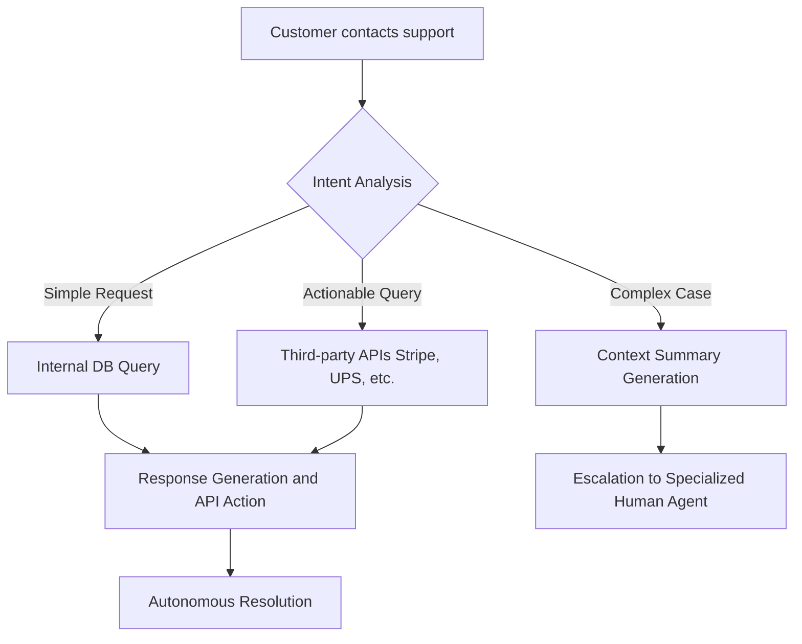

# The 5 AI Automation Workflows Replacing Entire Departments in 2026

Forget clumsy little chatbots or Excel macros that crash half the time. In 2026, automation via Artificial Intelligence has crossed a critical threshold. We're no longer talking about saving "a few hours a week" on repetitive tasks, but rather **autonomous systems capable of replacing entire departments**.

> According to a recent McKinsey study (Q1 2026), **over 42% of Fortune 500 companies** have already restructured their operations around end-to-end AI workflows. The result? A 60% reduction in operational costs and near-infinite scalability.

In this massive masterclass (Pillar Page), we will dissect the **5 most powerful AI automation workflows** redefining the modern enterprise. Get ready, the future of work is already here.

---

## 1. The "Autonomous Customer Success" Workflow (Replaces L1 & L2 Support)

Traditional customer support, with its endless tickets and frustrating wait times, is obsolete. Today's autonomous Customer Success workflow handles 95% of requests without any human intervention, with a satisfaction rate higher than that of human operators.

### How Does It Work?

Instead of a simple decision tree, this workflow uses LLMs (Large Language Models) connected directly to the company's database, CRM, and carrier/supplier APIs.

*   **Multi-channel ingestion:** The AI reads emails, listens to voicemails, and analyzes chats in real time.
*   **Active resolution:** It doesn't just reply: it acts. If a customer requests a refund, the AI checks the policy, validates eligibility, initiates the wire transfer via the Stripe API, and generates the credit note.
*   **Predictive escalation:** Only emotionally complex or high-stakes cases (the remaining 5%) are transferred to a human with an ultra-detailed summary.

### Customer Success Workflow Architecture

---

## 2. The Hyper-Personalized SEO Content Factory (Replaces the Editorial Team)

Content creation at scale is no longer the exclusive domain of massive editorial teams. In 2026, a single "Prompt Engineer" oversees a workflow that generates thousands of perfectly optimized articles, LinkedIn posts, and newsletters aligned with the brand's voice.

### The Internal Mechanics

This isn't basic text generation. It's a smart editorial assembly line:

1.  **Monitoring and Strategy (Scraping Agents):** Autonomous agents scan the web, identifying emerging trends and low-competition keywords.
2.  **Outline Creation (Architect Agent):** The AI generates an SEO-optimized semantic structure (TF-IDF, search intents).
3.  **Writing and Fact-Checking (Writer Agent + Verifier Agent):** The text is written, then cross-referenced with reliable sources to avoid hallucinations.
4.  **Distribution (Social Agent):** The final article is sliced into Twitter threads, LinkedIn posts, and TikTok scripts.

> **Data Point:** Companies using this workflow see their organic traffic multiplied by 4 on average in under 6 months, with customer acquisition costs (CAC) divided by 3.

---

## 3. The "Zero-Bias" AI Recruiter (Replaces HR Sourcing)

Candidate sourcing is a time-consuming and often biased task. The AI recruiting workflow automates headhunting from A to Z.

### The Reverse Filtering Process

*   **Targeted Scraping:** The AI identifies passive profiles on LinkedIn, GitHub, or Dribbble based on hyper-specific skills, going way beyond simple keywords.
*   **Hyper-Personalized Outreach:** It writes unique outreach emails based on the candidate's recent projects (e.g., "I saw your latest commit on that open-source repo...").
*   **Voice Pre-qualification:** Initial interviews are conducted by a voice AI (like Hume AI) that evaluates soft skills, baseline technical level, and cultural fit in 15 minutes.
*   **Final Shortlist:** The HR director only meets the Top 3%.

---

## 4. The Virtual CFO (Replaces Accounts Payable)

Invoice management, bank reconciliation, and expense reports no longer require manual data entry. The AI accounting workflow acts as an operational Virtual CFO, 24/7.

### The Autonomous Financial Circuit

*   **Visual Extraction (Vision Language Models):** The AI instantly extracts data from any crumpled receipt or complex invoice (amounts, VAT, registration numbers).
*   **3-Way Matching:** It automatically verifies that the invoice matches the purchase order and the proof of delivery.
*   **Fraud Detection:** Predictive analysis of anomalies (unusual amounts, duplicate billing, ghost suppliers).
*   **Programmed Payment:** Once validated, the invoice is integrated into the ERP and scheduled for payment at the optimal due date for cash flow.

---

## 5. The Omnipresent SDR (Replaces Sales Development Reps)

B2B prospecting has radically changed. Goodbye "spray and pray". The AI SDR orchestrates complex multi-channel campaigns with a level of personalization impossible for a human at scale.

### The Next-Gen Prospecting Funnel

1.  **Intent Signals:** The AI monitors buying signals (fundraising, key hires, press mentions).
2.  **Dynamic Icebreakers:** Generation of opening lines based on the prospect's immediate news.
3.  **Objection Handling:** If the prospect replies "no time," the AI analyzes the tone and cleverly offers a relevant asynchronous resource rather than a forced meeting.
4.  **Advanced Qualification:** As soon as a prospect shows genuine interest (high engagement score), the workflow books a meeting directly into the Account Executive's (AE) calendar.

---

## How to Implement These Workflows Tomorrow?

The transition to these workflows doesn't happen overnight. It requires clean data infrastructure and phased adoption.

**Your 3-step action plan:**

1.  **Audit your bottlenecks:** Which department consumes the most time on repetitive tasks? (Often support or accounting).
2.  **Map the process:** Break down every human step. If the step involves "reading info A to copy it into system B," it's automatable.
3.  **Deploy iteratively:** Start with a hybrid (Human-in-the-loop) workflow where the AI suggests actions that a human validates, before moving to 100% autonomous.

**The stake in 2026 is no longer *if* AI can replace these processes, but how fast your competitors will implement it before you do. The workflow revolution is underway.**
