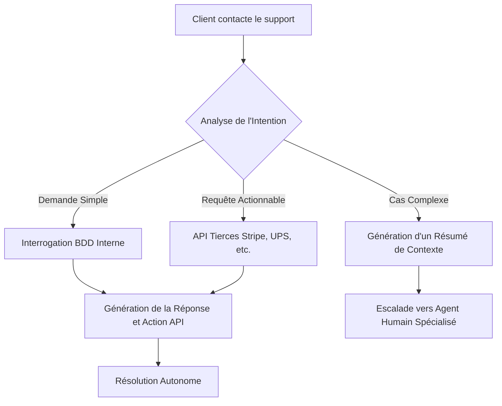

# Les 5 Workflows d'Automatisation IA Qui Remplacent un Département Entier en 2026

Oubliez les petits chatbots maladroits ou les macros Excel qui plantent une fois sur deux. En 2026, l'automatisation par l'Intelligence Artificielle a franchi un cap critique. Nous ne parlons plus de gagner "quelques heures par semaine" sur des tâches répétitives, mais bien de **systèmes autonomes capables de remplacer des départements entiers**. 

> Selon une étude récente de McKinsey (T1 2026), **plus de 42% des entreprises du Fortune 500** ont déjà restructuré leurs opérations autour de workflows IA "end-to-end". Le résultat ? Une réduction des coûts opérationnels de 60% et une scalabilité quasi infinie.

Dans cette masterclass massive (Pillar Page), nous allons décortiquer les **5 workflows d'automatisation IA les plus puissants** qui redéfinissent l'entreprise moderne. Préparez-vous, le futur du travail est déjà là.

---

## 1. Le Workflow "Customer Success Autonome" (Remplace le Support Niveaux 1 & 2)

Le support client traditionnel, avec ses tickets interminables et ses temps d'attente frustrants, est obsolète. Le workflow de Customer Success autonome gère aujourd'hui 95% des requêtes sans aucune intervention humaine, avec un taux de satisfaction supérieur à celui des opérateurs humains.

### Comment ça marche ?

Au lieu d'un simple arbre de décision, ce workflow utilise des LLMs (Large Language Models) connectés directement à la base de données de l'entreprise, au CRM et aux API des transporteurs/fournisseurs.

*   **Ingestion multicanale :** L'IA lit les emails, écoute les messages vocaux et analyse les chats en temps réel.
*   **Résolution active :** Elle ne se contente pas de répondre : elle agit. Si un client demande un remboursement, l'IA vérifie la politique, valide l'éligibilité, initie le virement via l'API Stripe et génère la facture d'avoir.
*   **Escalade prédictive :** Seuls les cas émotionnellement complexes ou à fort enjeu (les 5% restants) sont transférés à un humain avec un résumé ultra-détaillé.

### Architecture du Workflow Customer Success

---

## 2. L'Usine à Contenu SEO Hyper-Personnalisée (Remplace l'Équipe Rédaction)

La création de contenu à l'échelle n'est plus l'apanage des immenses équipes éditoriales. En 2026, un seul "Prompt Engineer" supervise un workflow qui génère des milliers d'articles, de posts LinkedIn et de newsletters parfaitement optimisés et alignés avec la voix de la marque.

### La Mécanique Interne

Ce n'est pas de la génération de texte basique. C'est une chaîne d'assemblage éditoriale intelligente :

1.  **Veille et Stratégie (Agents Scraping) :** Des agents autonomes scannent le web, identifient les tendances émergentes et les mots-clés à faible concurrence.
2.  **Création du Plan (Agent Architecte) :** L'IA génère une structure sémantique optimisée pour le SEO (TF-IDF, intentions de recherche).
3.  **Rédaction et Fact-Checking (Agent Rédacteur + Agent Vérificateur) :** Le texte est rédigé, puis croisé avec des sources fiables pour éviter les hallucinations.
4.  **Distribution (Agent Social) :** L'article final est découpé en threads Twitter, posts LinkedIn et scripts TikTok.

> **Data Point :** Les entreprises utilisant ce workflow voient leur trafic organique multiplié par 4 en moyenne en moins de 6 mois, avec un coût d'acquisition client (CAC) divisé par 3.

---

## 3. Le Recruteur IA "Zero-Bias" (Remplace le Sourcing RH)

Le sourcing de candidats est une tâche chronophage et souvent biaisée. Le workflow de recrutement IA automatise la chasse de têtes de A à Z.

### Le Processus de Filtrage Inversé

*   **Scraping Ciblé :** L'IA identifie des profils passifs sur LinkedIn, GitHub, ou Dribbble en fonction de compétences hyper-spécifiques, au-delà des simples mots-clés.
*   **Outreach Hyper-Personnalisé :** Elle rédige des emails d'approche uniques en se basant sur les projets récents du candidat (ex: "J'ai vu ton dernier commit sur ce repo open source...").
*   **Préqualification Vocale :** Les premiers entretiens sont menés par une IA vocale (type Hume AI) qui évalue les soft skills, le niveau technique de base et l'adéquation culturelle en 15 minutes.
*   **Shortlist Finale :** Le directeur RH ne rencontre que le Top 3%.

---

## 4. Le Directeur Financier Virtuel (Remplace la Compta Fournisseurs)

La gestion des factures, le rapprochement bancaire et les notes de frais ne requièrent plus de saisie manuelle. Le workflow comptable IA agit comme un DAF virtuel opérationnel 24/7.

### Le Circuit Financier Autonome

*   **Extraction Visuelle (Vision Language Models) :** L'IA extrait instantanément les données de n'importe quel reçu froissé ou facture complexe (montants, TVA, SIRET).
*   **Matching à 3 Voies :** Elle vérifie automatiquement que la facture correspond au bon de commande et à la preuve de livraison.
*   **Détection de Fraude :** Analyse prédictive des anomalies (montants inhabituels, double facturation, fournisseurs fantômes).
*   **Paiement Programmé :** Une fois validée, la facture est intégrée à l'ERP et programmée pour paiement à la date d'échéance optimale pour la trésorerie.

---

## 5. Le SDR Omniprésent (Remplace les Sales Development Reps)

La prospection B2B a radicalement changé. Fini le "spray and pray". Le SDR IA orchestre des campagnes complexes multicanales avec un niveau de personnalisation impossible pour un humain à grande échelle.

### L'Entonnoir de Prospection Nouvelle Génération

1.  **Signaux d'Intention :** L'IA surveille les signaux d'achat (levées de fonds, recrutements clés, mentions dans la presse).
2.  **Icebreakers Dynamiques :** Génération d'accroches basées sur l'actualité immédiate du prospect.
3.  **Gestion des Objections :** Si le prospect répond "pas le temps", l'IA analyse le ton et propose habilement une ressource asynchrone pertinente plutôt qu'un rendez-vous forcé.
4.  **Qualification Avancée :** Dès qu'un prospect montre un intérêt réel (score d'engagement élevé), le workflow booke un rendez-vous directement dans l'agenda de l'Account Executive (AE).

---

## Comment Implémenter Ces Workflows Demain ?

La transition vers ces workflows ne se fait pas du jour au lendemain. Elle nécessite une infrastructure de données propre et une adoption par phases. 

**Votre plan d'action en 3 étapes :**

1.  **Auditez vos goulots d'étranglement :** Quel département consomme le plus de temps sur des tâches répétitives ? (Souvent le support ou la comptabilité).
2.  **Cartographiez le processus :** Décomposez chaque étape humaine. Si l'étape implique de "lire une info A pour la copier dans un système B", elle est automatisable.
3.  **Déployez par itérations :** Commencez par un workflow hybride (Human-in-the-loop) où l'IA suggère des actions qu'un humain valide, avant de passer en 100% autonome.

**L'enjeu en 2026 n'est plus de savoir *si* l'IA peut remplacer ces processus, mais à quelle vitesse vos concurrents vont l'implémenter avant vous. La révolution des workflows est en marche.**
